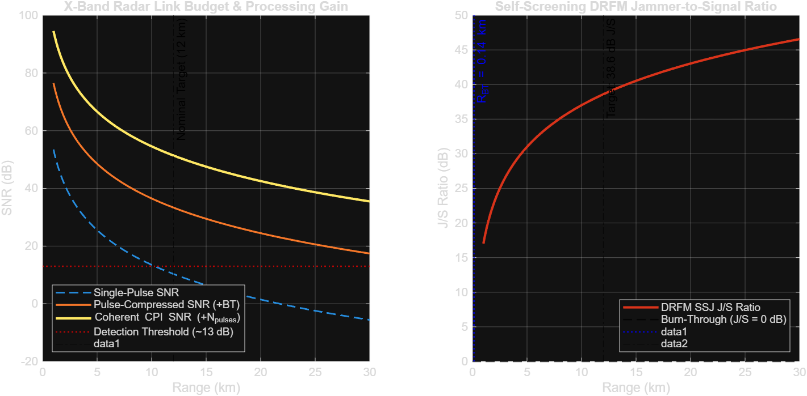
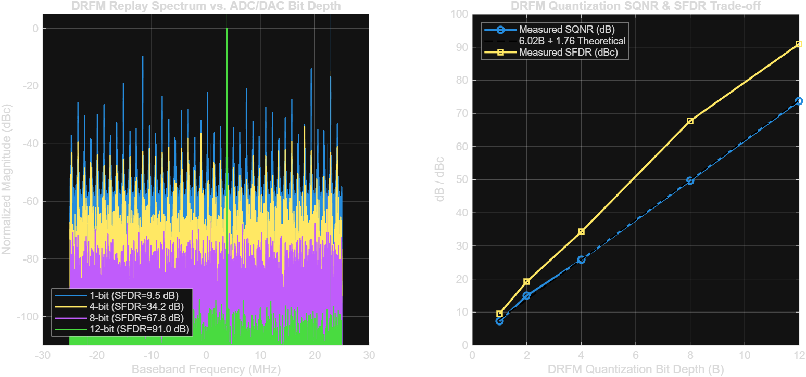
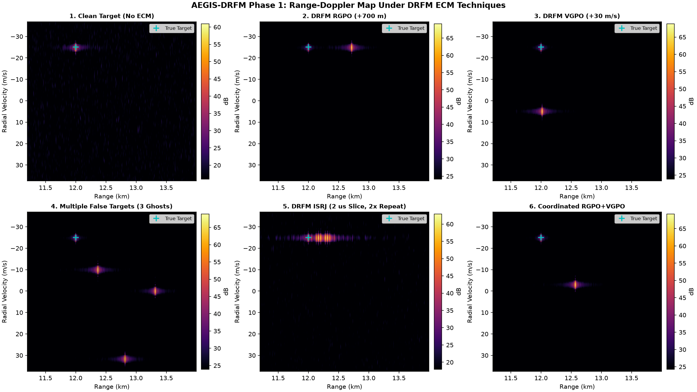
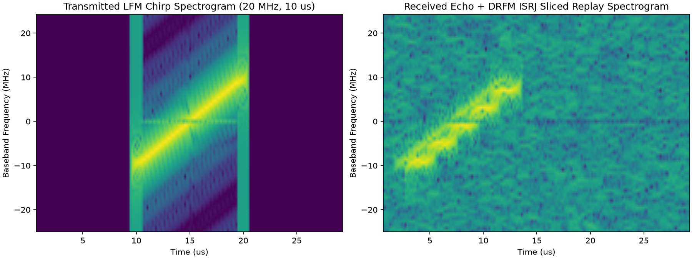
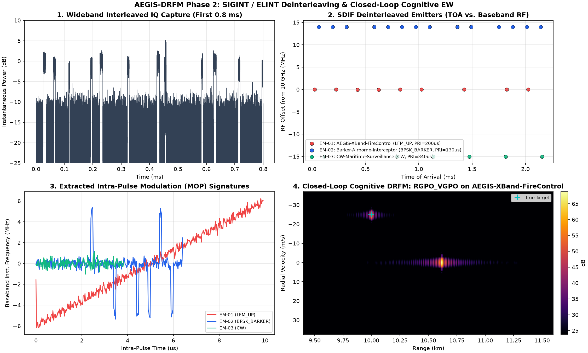
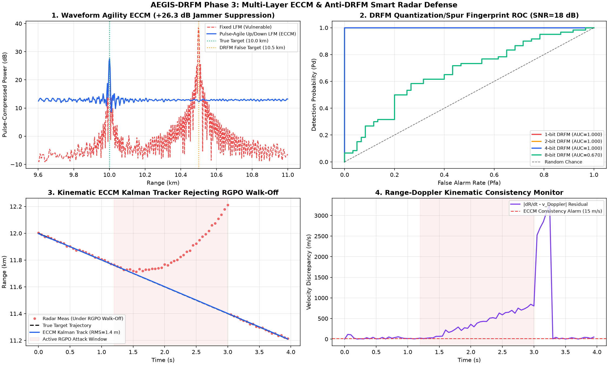
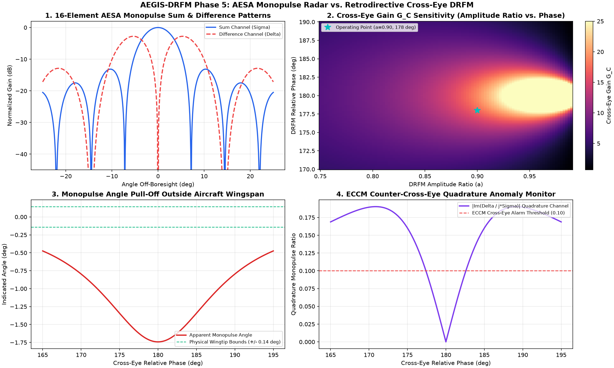
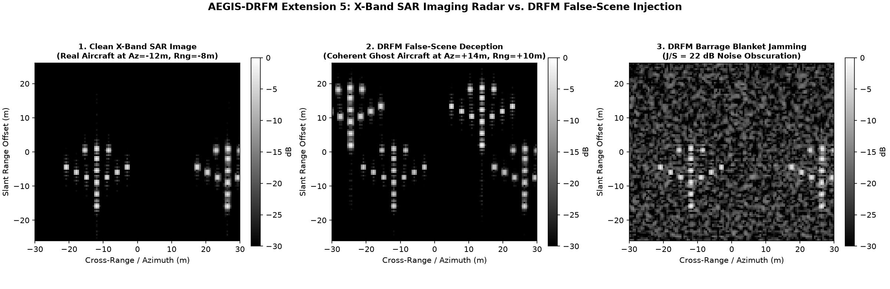
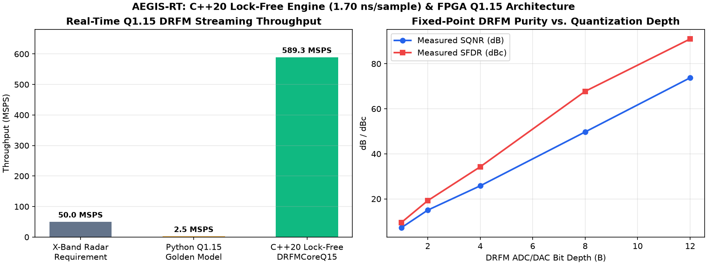

# AEGIS-DRFM — Unified Electronic Warfare, Radar, SIGINT, ECCM, AESA, SAR & Real-Time C++20/FPGA Suite

**Adaptive Electronic-warfare, Ground-truth RF, Intelligence & Signal-processing Suite**

AEGIS-DRFM; **DRFM (Digital Radio Frequency Memory)** çekirdeği etrafında uçtan uca geliştirilmiş, **Python + MATLAB R2025b + C++20 + SystemVerilog (FPGA) + Canlı Web EW Studio** teknolojilerini tek bir modüler mimaride birleştiren kapsamlı Elektronik Harp (EW), Radar, RF ve SIGINT platformudur.

---

## Ekosistem Özeti

| Modül | Klasör | Öne Çıkan Yetenekler | Doğrulanan Başarım |
|---|---|---|---|
| **1. Radar & RF Kanalı** | `packages/core-dsp/` | LFM/Barker/Frank, PRI (Sabit/Staggered/Jittered), kesirli gecikme, Doppler, multipath, LO faz gürültüsü, I/Q dengesizliği, Matched Filter, RD Map, CA/OS-CFAR | MATLAB R2025b ile birebir çözünürlük & BT kazancı |
| **2. DRFM & ECM Motoru** | `packages/drfm-ecm/` | 1–12 bit ADC/DAC kuantalama, 120 ns donanım döngü gecikmesi, RGPO, VGPO, Koordineli RGPO+VGPO, Çoklu Sahte Hedef, ISRJ, Gürültü Karıştırma | 1–12 bit SQNR / SFDR / ENOB MATLAB çapraz doğrulamalı |
| **3. SIGINT / ELINT & Bilişsel ESM** | `packages/sigint-esm/` | Kör darbe tespiti, PDW çıkarımı, MOP sınıflandırıcı (`LFM_UP/DOWN`, `BPSK_BARKER`, `CW`), SDIF deinterleaver, Tehdit Kütüphanesi & kapalı döngü EW | 3 eşzamanlı X-Band radarında `1.00` güvenle ayrıştırma |
| **4. ECCM Akıllı Radar** | `packages/eccm-radar/` | Darbe-darbe dalgaformu çevikliği, DRFM parmak izi Fisher LDA dedektörü (ROC/AUC), Kinematik Kalman anti-RGPO/VGPO izleyici | **+26.3 dB** bastırma, 1–4 bit **AUC=1.000**, Kalman RMS **251m → 1.4m** |
| **5. AESA Monopulse & Cross-Eye** | `packages/aesa-monopulse/` | 16-eleman X-Band ULA $\Sigma/\Delta$ hüzmeleme, retrodirective Cross-Eye DRFM açı aldatma, Quadrature ECCM dedektörü | **11.6x** kanat açıklığı sapma, MATLAB ile 4 ondalık eşleşme |
| **6. SAR Görüntüleme & DRFM Aldatma** | `packages/sar-isar/` | X-Band 2D SAR faz geçmişi, tam hiperbolik Time-Domain Backprojection (TDBP), hayalet savaş uçağı (false-scene) enjeksiyonu | 1 m sınıfı 2B odaklama & sahte uçak enjeksiyonu |
| **7. C++20 RT Motor, SDR & FPGA RTL** | `packages/rt-cpp-engine/` | Lock-free SPSC ring buffer, `Q1.15` DRFM, Python `ctypes` native DLL köprüsü, SoapySDR arayüzü, sentezlenebilir SystemVerilog AXI-Stream RTL | **580–608 MSPS** (`1.64–1.72 ns/sample`), **0-LSB** bit-exact |
| **8. MATLAB R2025b & Web EW Studio** | `matlab/`, `apps/web-ew-studio/` | RF bütçesi, J/S, burn-through, ADC SFDR, AESA Cross-Eye altın modelleri & canlı tarayıcı konsolu | 3 bağımsız MATLAB ↔ Python çapraz doğrulama testi |

---

## Görsel Çıktılar

### MATLAB R2025b Sistem Tasarımı & DRFM Kuantalama (SFDR / ENOB)



### Faz 1: DRFM ECM Range-Doppler Galerisi & ISRJ Spektrogramı



### Faz 2: SIGINT / ELINT Ayrıştırma & Bilişsel EW


### Faz 3: Çok Katmanlı ECCM & Anti-DRFM Savunma


### Faz 4–6: AESA Monopulse & Cross-Eye DRFM + SAR Sahte Sahne Enjeksiyonu



### Gerçek Zamanlı C++20 (~590 MSPS) & Sabit Noktalı Q1.15 FPGA Performansı


---

## Hızlı Başlangıç

### 1. Kurulum & Tüm Doğrulama Testleri (18/18)
```powershell
pip install -r requirements.txt
python -m unittest discover -s tests -v
```

### 2. Görsel Demolar
```powershell
python apps/ew-studio/run_phase1_demo.py
python apps/ew-studio/run_phase2_sigint_demo.py
python apps/ew-studio/run_phase3_eccm_demo.py
python apps/ew-studio/run_phase5_aesa_demo.py
python apps/ew-studio/run_phase9_sar_demo.py
```

### 3. Canlı Web EW Studio Arayüzü
```powershell
python apps/web-ew-studio/server.py
# Tarayıcıda aç: http://127.0.0.1:8765
```

### 4. MATLAB R2025b Altın Referans Modelleri
```powershell
matlab -batch "addpath(genpath('matlab')); rf_ew_system_design(); drfm_quantization_sfdr(); aesa_monopulse_crosseye_design();"
```

### 5. C++20 Native DLL & Benchmark Derleme (Windows)
```powershell
powershell -ExecutionPolicy Bypass -File .\scripts\setup_cpp_hil.ps1
```

---

## Detaylı Mühendislik Raporu
Tüm modüllerin mimari gerekçeleri, fiziksel/matematiksel denklemleri ve doğrulama tabloları için bkz: [docs/MASTER_PROJECT_REPORT.md](docs/MASTER_PROJECT_REPORT.md).
